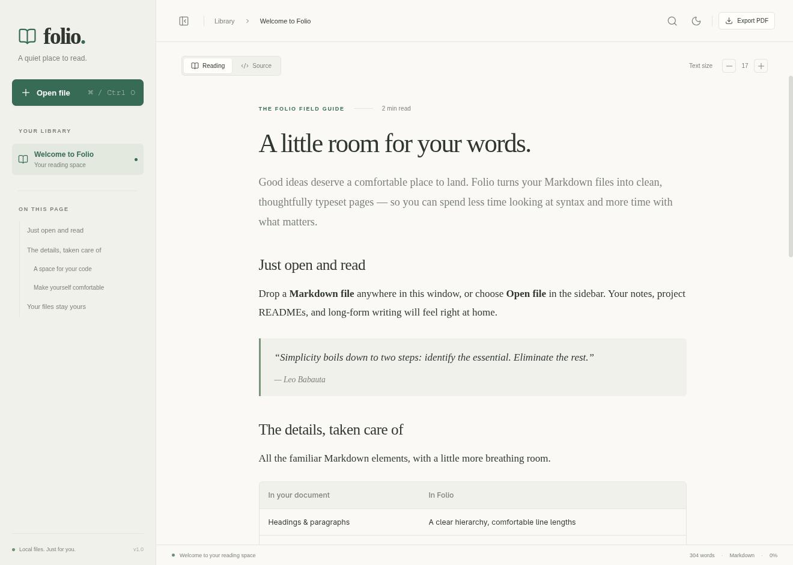
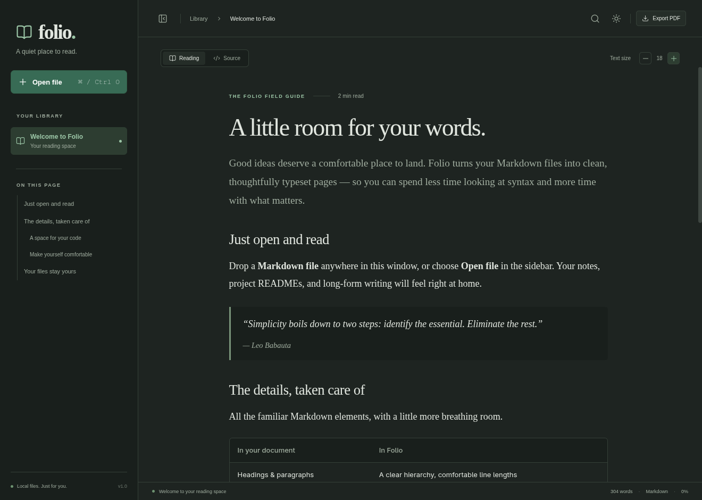

<p align="center">
  
</p>

<h1 align="center">Folio</h1>
<p align="center"><strong>A quiet place to read Markdown.</strong></p>
<p align="center">A local desktop reader for your notes, READMEs, and long-form writing.</p>

<p align="center">
  <a href="https://github.com/aravmdn/folio/actions/workflows/ci.yml"></a>
  <a href="LICENSE"></a>
  <a href="https://github.com/aravmdn/folio/issues"></a>
</p>



Folio opens Markdown files directly from your computer and gives them a comfortable reading layout. Choose a file, drop it onto the window, or launch it from your terminal. The document stays in its original location, and the view refreshes when you edit it elsewhere.

There are no accounts, document uploads, analytics, or cloud services. Folio is a **read-only reader**: it does not edit your Markdown files.

[Get started](#get-started) · [Features](#features) · [Privacy](#privacy-and-local-storage) · [Development](#development) · [Contributing](#contributing)

## Features

- **A comfortable reading view.** Paper and dark themes, adjustable text size from 14–24 px, and a collapsible sidebar.
- **Familiar Markdown.** Headings, tables, task lists, blockquotes, links, strikethrough, and fenced code blocks. Task checkboxes are displayed read-only.
- **Code you can use.** Syntax highlighting for common languages and a copy button on code blocks.
- **Find your place.** A heading outline, case-insensitive text search, word count, estimated reading time, and scroll progress.
- **Local file navigation.** Up to 15 recent file paths, links to other Markdown documents, and local images inside the document's directory or its subdirectories.
- **Live refresh.** Changes made in another editor appear automatically, including files saved by replacement.
- **Source and export.** View the original Markdown or export the rendered document as an A4 PDF. YAML-style front matter is shown in a collapsible metadata section.

<details>
<summary>See the dark theme</summary>



</details>

## Project status

Folio is a new, source-distributed project. **Linux is the tested platform**, and the desktop integration script is Linux-only. CI builds and exercises the real Electron app on Ubuntu. Windows and macOS are not currently validated or supported by platform-specific installers.

There are no packaged installers, signed binaries, automatic updates, or npm-published releases at present. The `1.0.0` package version identifies the initial implementation; it does not imply that a binary release is available. See the [changelog](CHANGELOG.md).

## Get started

You need **Git**, **Node.js 24 or newer**, **npm**, and a Linux graphical session. The repository's `.nvmrc` selects Node.js 24. Dependency setup and the first launch may download packages and the Electron runtime; reading works offline after setup.

```sh
git clone https://github.com/aravmdn/folio.git
cd folio
npm ci
npm start
```

`npm start` builds the frontend and opens the desktop app. It does not start a web server.

Use **Open file**, drag a file into the window, or supply its path:

```sh
npm start -- /absolute/path/to/notes.md
```

### Add Folio to the Linux app menu

From the checkout:

```sh
npm run install-local
```

This builds the app and creates two user-level files:

| File                                        | Purpose                                                   |
| ------------------------------------------- | --------------------------------------------------------- |
| `~/.local/bin/folio`                        | Launches Electron with this checkout                      |
| `~/.local/share/applications/folio.desktop` | Adds an app-menu entry and Markdown **Open With** support |

No administrator access is needed. The installer does not change your default Markdown application. **Keep the checkout and its `node_modules` directory in place**: this is a launcher installation, not a standalone binary.

Open Folio from your app menu, use your file manager's **Open With** menu, or run:

```sh
~/.local/bin/folio /path/to/notes.md
```

If `~/.local/bin` is on your `PATH`, you can use `folio` directly. The installer does not edit your shell configuration. If you move the checkout, run `npm run install-local` again from its new location.

### Update or uninstall

To update an unmodified checkout, close Folio and run:

```sh
git pull --ff-only
npm ci
npm run install-local
```

To remove desktop integration:

```sh
npm run uninstall-local
```

Uninstallation removes only Folio's launcher and desktop entry. It leaves your documents, settings, and checkout in place, and refuses to remove files without Folio's installer marker.

## Using Folio

| Action                        | Shortcut                                     |
| ----------------------------- | -------------------------------------------- |
| Open a Markdown file          | `Ctrl+O`                                     |
| Find in the current view      | `Ctrl+F`                                     |
| Next / previous search result | `Enter` / `Shift+Enter`, with search focused |
| Close search                  | `Escape`                                     |
| Show or hide the sidebar      | `Ctrl+B`                                     |
| Export PDF                    | `Ctrl+P`                                     |

The source also defines Command-key equivalents for macOS, but macOS behavior has not been validated.

Click headings in **On this page** to navigate. **Reading** and **Source** switch between the rendered document and its original text. PDF export switches to the reading view and uses a light print layout regardless of the selected screen theme.

### Supported files and limitations

- Extensions: `.md`, `.markdown`, `.mdown`, `.mkd`, and `.mdx`, case-insensitively. Files are read as UTF-8, up to **10 MiB** each.
- MDX is treated as Markdown. JSX components and embedded JavaScript are not executed. There is no editing, math rendering, Mermaid rendering, plugin system, or folder browser.
- Local image formats: PNG, JPEG, GIF, WebP, SVG, AVIF, BMP, and ICO. Relative image paths must stay inside the opened document's directory, including after resolving symlinks. Base64-embedded PNG, JPEG, GIF, and WebP images are also supported.
- Remote images are replaced with offline placeholders. HTTP(S) and mail links open in your default browser or mail handler **only when clicked**. Other local file links must point to Markdown documents.
- HTML is sanitized. Scripts, embedded media, forms, custom styles, and other active content are removed or disabled. Some GitHub-specific HTML presentation will therefore look different.
- Search matches text within individual rendered text nodes. A phrase split by inline formatting may not match in Reading; use Source to search the original syntax.
- A file's current scroll position survives live refresh, but reading positions are not saved across app restarts. Recent paths are remembered; the last document is not automatically reopened.

## Privacy and local storage

Folio reads documents into memory and never writes changes back to them. It saves recent paths and display preferences on this device:

| Data                                          | Storage                                                |
| --------------------------------------------- | ------------------------------------------------------ |
| Up to 15 recent file names and absolute paths | `recent.json` inside Electron's user-data directory    |
| Theme and text-size preferences               | Renderer local storage in the same user-data directory |
| Exported PDFs                                 | The destination you choose in the save dialog          |

On Linux, the user-data directory is normally `~/.config/Folio` (or `Folio` beneath `XDG_CONFIG_HOME`). Chromium also maintains its own runtime caches there. Folio does not intentionally persist document bodies or a document library.

Use the trash button beside **Your library** to clear the saved recent list. This does not delete any documents. To reset all settings, close Folio and remove its user-data directory.

The application has no telemetry or network-backed document features. Dependencies and Electron downloads require a connection during setup, and explicitly opened external links leave the app. GitHub-hosted README badges are documentation assets; they are not required by the application.

See [SECURITY.md](SECURITY.md) for security boundaries and private vulnerability reporting.

## Development

```sh
npm ci
npm run format:check
npm test
```

`npm test` builds the frontend and launches real Electron windows using Playwright with temporary files and isolated settings. It checks document opening through the native-dialog bridge, drag-and-drop, command-line paths, rendering, local images, search, source view, clipboard copying, themes, recent files, live refresh, invalid-file handling, HTML sanitization, offline behavior, and PDF generation. Dialog selections are stubbed; the operating system's picker UI is not automated. The clipboard check writes a sample code snippet to the system clipboard.

Screenshots, a sample PDF, and failure diagnostics are written to the ignored `output/playwright/` directory. These are functional checks, not visual-diff or accessibility certification tests.

| Command                   | Purpose                                                       |
| ------------------------- | ------------------------------------------------------------- |
| `npm start`               | Build and launch the desktop app                              |
| `npm run build`           | Generate the frontend in `dist/`                              |
| `npm run dev`             | Run a Vite browser preview on loopback; use the URL it prints |
| `npm test`                | Build and run the Electron smoke suite                        |
| `npm run format`          | Format source and documentation with Prettier                 |
| `npm run format:check`    | Check formatting without modifying files                      |
| `npm run install-local`   | Build and install Linux desktop integration                   |
| `npm run uninstall-local` | Remove Linux desktop integration                              |

The browser preview supports single-file input and drag-and-drop. It does **not** provide desktop file watching, saved recent paths, relative Markdown/image access, or the native PDF save flow; browser printing replaces PDF export there. Restart `npm start` to test desktop code changes.

For headless Linux testing, install the required system dependencies and use Xvfb:

```sh
npx playwright install-deps chromium
xvfb-run --auto-servernum npm test
```

The dependency command may request administrator privileges to install system packages. A separate Playwright browser download is not needed: these tests launch Electron's Chromium runtime.

Read the [architecture guide](docs/ARCHITECTURE.md) for the code map and [CONTRIBUTING.md](CONTRIBUTING.md) for the pull-request workflow.

## Troubleshooting

**`folio` is not found:** use `~/.local/bin/folio`, or add `~/.local/bin` to your shell's `PATH` yourself.

**The launcher stops working after moving the project:** reinstall it from the new checkout location. Make sure `npm ci` and `npm run build` have completed.

**Electron reports a missing shared library or display:** use a graphical Linux session with Electron's system dependencies installed. For CI, use the Xvfb commands above. Distribution sandbox policies may require a local system adjustment; Folio does not disable Electron's sandbox to work around them.

**An image is missing:** check the relative path, filename capitalization, supported format, and whether the resolved file is inside the Markdown document's directory. Remote images intentionally stay offline.

**A recent file no longer opens:** recent entries store paths, not copies. Reopen the file from its new location or clear the recent list.

For other problems, [open a bug report](https://github.com/aravmdn/folio/issues/new?template=bug_report.yml) with your operating system, Node version, the commit you tried, and a small non-sensitive example.

## Contributing

Bug fixes, documentation improvements, test cases, and accessibility improvements are welcome. For a larger change, open an issue describing the problem and proposed behavior before building it.

Read [CONTRIBUTING.md](CONTRIBUTING.md) and the [Code of Conduct](CODE_OF_CONDUCT.md). There is no CLA; contributions are made under the project's MIT license. Feature requests are proposals, not release commitments.

## Built with

[Electron](https://www.electronjs.org/), [Vite](https://vite.dev/), [Marked](https://marked.js.org/), [DOMPurify](https://github.com/cure53/DOMPurify), [highlight.js](https://highlightjs.org/), [Lucide](https://lucide.dev/), and [Playwright](https://playwright.dev/).

Folio's source is licensed under the [MIT License](LICENSE), copyright © 2026 Arav Madan. Dependencies retain their own licenses; see [third-party notices](THIRD_PARTY_NOTICES.md).
